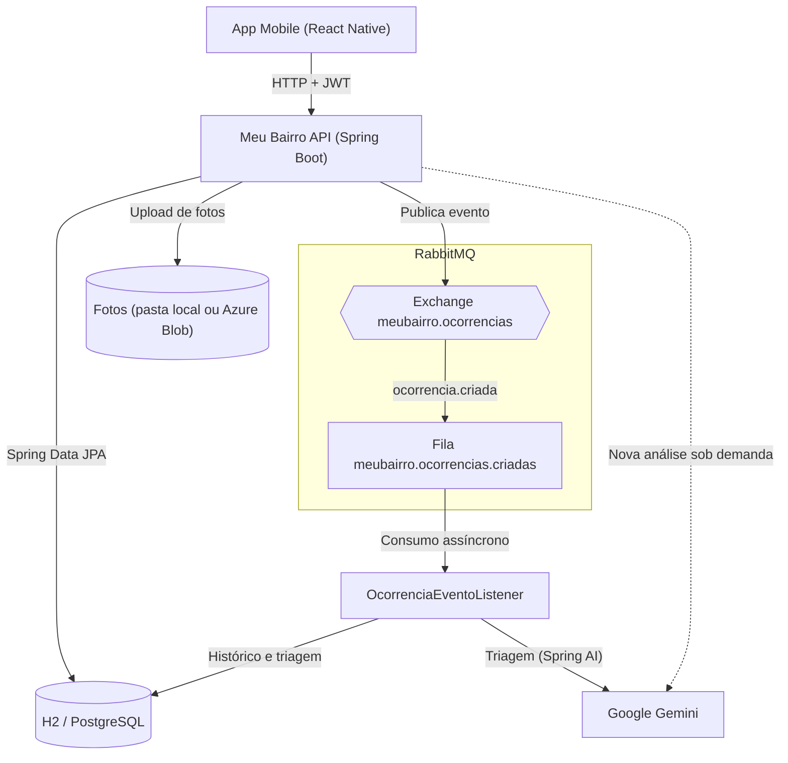

# Meu Bairro — API Java

API REST em Java e Spring Boot do **Meu Bairro**, solução CitizenTech de zeladoria colaborativa desenvolvida para a Global Solution FIAP 2026/2 (2º ano de Análise e Desenvolvimento de Sistemas). É o backend consumido pelo aplicativo Mobile do grupo.

Buracos, postes apagados, lixo acumulado, alagamentos e calçadas quebradas precisam ser identificados, priorizados e acompanhados. No Meu Bairro, o cidadão registra o problema com foto e localização, uma IA generativa sugere a categoria e a prioridade, e o gestor público atualiza o atendimento, com o histórico visível para quem fez o relato.

Principais funcionalidades:

- Cadastro e login com JWT, com os perfis `CIDADAO` e `GESTOR`.
- Registro de ocorrências com endereço, coordenadas e foto opcionais.
- Triagem automática pelo Google Gemini: categoria, prioridade e justificativa.
- Processamento assíncrono da triagem com RabbitMQ.
- Histórico de andamento de cada ocorrência.
- Gestão de status, prioridade manual, resumo e categorias pelo gestor.

A tabela abaixo mostra como cada requisito de Java Advanced foi atendido.

| Requisito | Implementação |
| --- | --- |
| API REST com 3+ entidades, CRUD e paginação | `Usuario`, `Ocorrencia`, `Categoria` e `HistoricoOcorrencia` com Spring Data JPA; CRUD de ocorrências e categorias; `GET /ocorrencias/paginado` |
| Validação e erros | Bean Validation nos DTOs e `@RestControllerAdvice` com resposta de erro padronizada |
| Segurança | Spring Security com JWT e os papéis `CIDADAO` e `GESTOR`, com rotas protegidas por papel |
| Spring AI | Triagem das ocorrências pelo Gemini dentro do fluxo de cadastro (não é um chat) |
| Arquitetura distribuída | Opção **A) RabbitMQ**: evento publicado e consumido de forma assíncrona |
| Documentação e integração | Swagger/OpenAPI e API consumida pelo app Mobile, com as rotas também no prefixo `/api` |

## Tecnologias

| Camada | Tecnologia |
| --- | --- |
| Base | Java 17, Spring Boot 3.5.16 e Maven Wrapper |
| Persistência | Spring Data JPA, H2 em arquivo e driver do PostgreSQL |
| Segurança | Spring Security, JWT (jjwt 0.12.6) e senhas com BCrypt |
| IA generativa | Spring AI 1.1.8 com Google Gemini (`gemini-3.5-flash-lite`) |
| Mensageria | RabbitMQ com Spring AMQP |
| Documentação | springdoc-openapi 2.10.0 (Swagger UI) |
| Testes | JUnit 5, Mockito, MockMvc, Awaitility e Apache Qpid (broker AMQP embarcado nos testes) |

## Arquitetura



- **API REST:** pacotes `controller`, `service`, `repository`, `entity`, `dto`, `security`, `messaging`, `exception` e `config`, em `src/main/java/br/com/fiap/meubairro`. O filtro JWT identifica o usuário em cada requisição, sem sessão no servidor.
- **Banco de dados:** H2 em arquivo (`./data/meubairro`) por padrão e PostgreSQL por variáveis de ambiente. Modelo: `Usuario` 1-N `Ocorrencia` N-1 `Categoria` e `Ocorrencia` 1-N `HistoricoOcorrencia`; a ocorrência também guarda a categoria sugerida pela IA.
- **Mensageria:** depois de salvar a ocorrência, a API publica um evento e responde `201`; o consumidor faz a triagem sem atrasar o app.
- **IA:** o Gemini é chamado pelo consumidor da fila e, sob demanda, por `POST /ocorrencias/{id}/analise-ia`.
- **Fotos:** gravadas na pasta do servidor com nome UUID e servidas em `GET /fotos/{arquivo}`, rota pública para o app exibir a imagem sem token. Em um deploy, a pasta precisa de disco persistente; a alternativa é o Azure Blob Storage.

## Como executar

Ambiente validado: Windows 11, JDK 17 e RabbitMQ 4.0.5 no Ubuntu 26.04 do WSL 2; não é preciso instalar o Maven. A API também sobe sem RabbitMQ e sem chave do Gemini: o cadastro continua funcionando, o histórico registra a falha da fila e a análise por IA responde `503`.

### 1. Instalar o RabbitMQ no WSL (uma vez)

No terminal do Ubuntu:

```bash
sudo apt update && sudo apt install -y rabbitmq-server
echo "listeners.tcp.default = 0.0.0.0:5672" | sudo tee /etc/rabbitmq/rabbitmq.conf
sudo rabbitmq-plugins enable rabbitmq_management
sudo systemctl restart rabbitmq-server
```

A segunda linha faz o RabbitMQ escutar em IPv4; sem ela, a API não conecta em `localhost`. Deixe um terminal do Ubuntu aberto enquanto usar a API e confira o serviço com `systemctl is-active rabbitmq-server`, que deve responder `active` (se não responder, rode `sudo systemctl start rabbitmq-server`). Com o Docker Desktop, a alternativa é `docker compose up -d rabbitmq` (não testada).

### 2. Subir a API

No PowerShell, na pasta do projeto:

```powershell
$chave = Read-Host "Chave do Gemini" -AsSecureString
$env:GEMINI_API_KEY = [System.Net.NetworkCredential]::new("", $chave).Password
.\mvnw.cmd spring-boot:run
```

O `Read-Host` lê a chave sem mostrá-la e sem gravá-la no histórico do PowerShell, e a variável vale só para essa janela. Sem chave, basta pressionar Enter: a API sobe sem a análise por IA. A primeira execução baixa o Maven e as dependências; a API está pronta quando o log mostra `Started MeuBairroApplication`. No Linux ou no macOS, use `sh mvnw spring-boot:run`.

- Swagger: <http://localhost:8080/swagger-ui.html> (faça login e use **Authorize** com o token)
- Painel do RabbitMQ: <http://localhost:15672> (usuário e senha `guest`)

### 3. Usuários de teste

| Perfil | E-mail | Senha |
| --- | --- | --- |
| CIDADAO | `cidadao@meubairro.com` | `Teste@123` |
| GESTOR | `gestor@meubairro.com` | `Teste@123` |

São criados na inicialização, se ainda não existirem, enquanto `USUARIOS_TESTE_HABILITADO=true`. O cadastro público sempre cria um `CIDADAO`; novos gestores só são criados por um gestor, em `POST /usuarios/gestores`.

### Variáveis de ambiente

| Variável | Padrão | Uso |
| --- | --- | --- |
| `GEMINI_API_KEY` | vazio | Chave do Gemini; sem ela, a análise por IA fica desativada |
| `GEMINI_MODELO` | `gemini-3.5-flash-lite` | Modelo usado na triagem |
| `IA_HABILITADA` | `true` | `false` desliga as chamadas à IA |
| `JWT_SECRET` | vazio | Segredo do JWT, com pelo menos 32 caracteres; vazio gera uma chave nova a cada inicialização |
| `JWT_EXPIRACAO_MINUTOS` | `120` | Validade do token |
| `DB_URL`, `DB_USERNAME`, `DB_PASSWORD` | H2 em `./data/meubairro`, `sa`, vazio | Banco de dados |
| `RABBITMQ_HOST`, `RABBITMQ_PORT` | `localhost`, `5672` | Endereço do RabbitMQ |
| `RABBITMQ_USERNAME`, `RABBITMQ_PASSWORD` | `guest`, `guest` | Usuário do RabbitMQ local |
| `FOTOS_PASTA` | `./data/fotos` | Pasta das fotos |
| `FOTOS_AZURE_CONTAINER_URL`, `FOTOS_AZURE_SAS_TOKEN` | vazio | Opcional: fotos no Azure Blob Storage (container com leitura pública dos blobs e token SAS com permissão de criar, gravar e excluir) |
| `USUARIOS_TESTE_HABILITADO`, `USUARIOS_TESTE_SENHA` | `true`, `Teste@123` | Criação dos usuários de teste |
| `CORS_ORIGENS` | `http://localhost:8081,http://localhost:19006` | Origens liberadas para o Expo Web |
| `PORT` | `8080` | Porta da API |

Cuidados com credenciais:

- Chaves e senhas reais (`GEMINI_API_KEY`, `JWT_SECRET`, `FOTOS_AZURE_SAS_TOKEN` e senhas de banco) ficam só em variáveis de ambiente, nunca em arquivos do projeto, commits, prints ou vídeos.
- O usuário `guest` do RabbitMQ, o usuário `sa` sem senha do H2 e a senha `Teste@123` servem só para uso local e demonstração.
- Em um ambiente publicado, defina um `JWT_SECRET` fixo e uma `USUARIOS_TESTE_SENHA` forte antes da primeira inicialização (ou `USUARIOS_TESTE_HABILITADO=false`, se já houver um gestor). A API não altera usuários que já existem no banco.

## Endpoints

A documentação interativa completa está no Swagger. Para autenticar, faça login em `POST /auth/login` e envie `Authorization: Bearer <token>` nas demais rotas. O token (HS256) vale 120 minutos e carrega o e-mail, o id e o perfil do usuário.

| Método | Rota | Acesso | Descrição |
| --- | --- | --- | --- |
| POST | `/auth/register` | Público | Cadastra um cidadão |
| POST | `/auth/login` | Público | Devolve o `token` e os dados do usuário |
| GET | `/usuarios/me` | Logado | Dados e perfil do usuário logado |
| POST | `/usuarios/gestores` | GESTOR | Cadastra outro gestor |
| GET | `/ocorrencias` | Logado | Lista todas, das mais recentes para as mais antigas |
| GET | `/ocorrencias/paginado` | Logado | Paginação (`page`, `size`, `sort`) com filtros `status`, `categoria` e `prioridade` |
| GET | `/ocorrencias/{id}` | Logado | Detalha uma ocorrência |
| POST | `/ocorrencias` | CIDADAO | Registra uma ocorrência (`multipart/form-data`) |
| PUT | `/ocorrencias/{id}` | Dono, se `ABERTA` | Atualiza a ocorrência (`multipart/form-data`) |
| DELETE | `/ocorrencias/{id}` | Dono, se `ABERTA`, ou GESTOR | Exclui a ocorrência e a foto |
| GET | `/ocorrencias/{id}/historico` | Logado | Histórico de andamento |
| GET | `/ocorrencias/{id}/triagem` | Logado | Prioridade atual e última análise da IA |
| POST | `/ocorrencias/{id}/analise-ia` | Dono ou GESTOR | Pede uma nova análise da IA |
| PATCH | `/ocorrencias/{id}/status` | GESTOR | Altera o status (`ABERTA`, `EM_ANALISE` ou `RESOLVIDA`) |
| PATCH | `/ocorrencias/{id}/prioridade` | GESTOR | Define a prioridade manualmente |
| GET | `/ocorrencias/resumo` | GESTOR | Totais por status e prioridade |
| GET | `/categorias`, `/categorias/{id}` | Logado | Lista e detalha as categorias |
| POST | `/categorias` | GESTOR | Cria uma categoria |
| PUT, DELETE | `/categorias/{id}` | GESTOR | Altera uma categoria ou exclui uma que não tenha ocorrências |
| GET | `/fotos/{arquivo}` | Público | Imagem da ocorrência (endereço da `fotoUrl`) |

- **Formulário da ocorrência:** `titulo` (5 a 120 caracteres), `descricao` (10 a 1000), `categoria` (`BURACO`, `ILUMINACAO`, `LIXO`, `ALAGAMENTO`, `CALCADA`, `OUTRO` ou outra criada pelo gestor), `endereco` (até 200), `latitude` e `longitude` opcionais e `foto` opcional (JPEG, PNG ou WEBP de até 5 MB, identificada pelo conteúdo). No `PUT`, as coordenadas e a foto não enviadas são mantidas.
- **Paginação:** 10 itens por padrão e no máximo 50, com ordenação por `id`, `titulo`, `status`, `dataCriacao` ou `dataAtualizacao`. A resposta traz `conteudo`, `pagina`, `tamanho`, `totalElementos`, `totalPaginas` e `ultima`.
- **Erros:** JSON padronizado com `status`, `message` e, nas validações, `fields`. Códigos: `400` dados inválidos, `401` sem token ou token inválido, `403` sem permissão, `404` não encontrado, `409` regra de negócio, `413` foto acima de 5 MB, `415` formato do corpo e `503` IA indisponível.
- **Regras de negócio:** só o cidadão registra ocorrências, que começam `ABERTA`; o dono altera ou exclui a sua enquanto ela estiver `ABERTA`, e o gestor pode excluir qualquer uma. Uma ocorrência `RESOLVIDA` não muda mais de status, a prioridade definida pelo gestor não é sobrescrita pela IA e as seis categorias usadas pelo app não podem ser excluídas nem mudar de código.

### Integração com o app Mobile

Todas as rotas também respondem com o prefixo `/api` (`/api/ocorrencias` e `/ocorrencias` são a mesma rota, com as mesmas regras de segurança). O app define a base em `EXPO_PUBLIC_API_URL`:

| Onde o app roda | `EXPO_PUBLIC_API_URL` |
| --- | --- |
| Emulador Android | `http://10.0.2.2:8080/api` |
| Celular na mesma rede (Expo Go) | `http://<IP do computador>:8080/api` |
| APK de entrega | `https://<endereço da API>/api`, depois do deploy HTTPS |

A ocorrência devolvida tem os mesmos campos do tipo `Ocorrencia` do app (`id`, `titulo`, `descricao`, `categoria`, `status`, `endereco`, `latitude`, `longitude`, `fotoUrl`, `criadoEm` e `usuarioId`), com datas no formato `2026-11-09T10:00:00`. A `fotoUrl` volta como URL completa, montada com o endereço usado pelo app (com `https://` atrás de um proxy HTTPS), e abre sem token. Se o Windows bloquear o celular, libere a porta como administrador: `New-NetFirewallRule -DisplayName "Meu Bairro API" -Direction Inbound -Protocol TCP -LocalPort 8080 -Action Allow`.

## Inteligência artificial e mensageria

### Triagem com o Gemini

1. O `AnaliseIaService` usa o `ChatClient` do Spring AI. A instrução de sistema traz as categorias cadastradas e os critérios de prioridade; o relato do cidadão vai separado, na mensagem do usuário.
2. Só o título e a descrição são enviados, com e-mails, CPFs e telefones trocados por marcadores. Nome, endereço, coordenadas, foto e token não saem da API.
3. O Gemini responde em JSON (temperatura 0,2), convertido no record `SugestaoIa`. A API confere se a categoria existe, se a prioridade é `BAIXA`, `MEDIA` ou `ALTA` e se há justificativa; caso contrário, descarta a sugestão.
4. A prioridade sugerida passa a valer se a ocorrência estiver `ABERTA` e o gestor não a tiver definido manualmente. A categoria escolhida pelo cidadão não muda; a sugestão fica visível para o gestor.

Na avaliação com o modelo real (`AvaliacaoGeminiTest`, em 10/11/2026), a IA acertou 15 de 15 categorias e 14 de 15 prioridades em relatos com resposta esperada, incluindo um que tenta manipular a IA, com média de 4,2 s a 4,7 s por análise em três execuções completas.

### Eventos com RabbitMQ

Fluxo: exchange `meubairro.ocorrencias` (direct) → routing key `ocorrencia.criada` → fila durável `meubairro.ocorrencias.criadas` → `OcorrenciaEventoListener`.

O `OcorrenciaService` salva a ocorrência, o `OcorrenciaEventoPublisher` publica o `OcorrenciaCriadaEvento` em JSON e a API responde `201` antes da triagem. O consumidor registra o recebimento no histórico e chama a IA; em erro inesperado, a mensagem é tentada 3 vezes e depois descartada. As alterações usam bloqueio de linha (`PESSIMISTIC_WRITE`), para que o consumidor e o gestor não sobrescrevam um ao outro. Na demonstração, o painel mostra a fila com 1 consumidor, o log mostra a publicação na thread da requisição (`nio-8080-exec-*`) e o consumo na do listener (`ntContainer#0-1`), e o histórico da ocorrência traz `CRIACAO`, `FILA` e `ANALISE_IA`.

### Limitações

- O Gemini depende de chave, cota e disponibilidade do serviço, e no nível gratuito o Google pode usar o conteúdo enviado para melhorar seus produtos. Cada chamada tem limite de 30 s e 2 tentativas; se falhar, a triagem fica `FALHA`, o histórico registra o motivo e a análise pode ser pedida de novo.
- A IA pode errar em casos de fronteira; por isso a sugestão é validada, fica visível ao gestor e a prioridade pode ser corrigida manualmente.
- Com o RabbitMQ fora do ar, o cadastro continua respondendo `201` e o consumidor reconecta sozinho, mas o evento não é reenviado: a análise daquela ocorrência precisa ser pedida manualmente.
- PostgreSQL, Docker e Azure Blob Storage estão preparados, mas não foram testados em ambiente real. Não há refresh token.

## Testes

```powershell
.\mvnw.cmd test
```

**Última execução (11/11/2026):** 150 testes, com 149 aprovados, 0 falhas e 1 ignorado (`AvaliacaoGeminiTest`, que só roda com a chave do Gemini). O resultado foi o mesmo com o broker AMQP embarcado e com o RabbitMQ real do WSL. Em 10/11/2026, os 150 passaram com o Gemini e o RabbitMQ reais.

| Tipo | O que cobre |
| --- | --- |
| Unitários | JWT, regras do `OcorrenciaService` com Mockito, validação da resposta da IA, remoção de dados pessoais, entidade `Ocorrencia` e fotos |
| Integração (MockMvc + H2) | Contrato do app, JWT, papéis, prefixo `/api`, CRUD multipart com foto, categorias, paginação, validações, erros e CORS |
| Persistência (`@DataJpaTest`) | Consultas com filtros, contagens, exclusão do histórico em cascata, unicidade e bloqueio de linha |
| IA | `ChatModel` falso com respostas válidas, fora do padrão e com falha, passando pelo `ChatClient` real |
| Mensageria | Publicação, consumo assíncrono e triagem disparada pelo evento |

Para usar o RabbitMQ real nos testes, deixe o broker rodando, pare a API e defina `$env:RABBITMQ_TESTE_REAL = "true"`. Para a avaliação com o Gemini real, que faz 15 chamadas ao modelo, informe a chave como no passo a passo, defina `$env:GEMINI_TESTE_REAL = "true"` e rode `.\mvnw.cmd test -Dtest=AvaliacaoGeminiTest`.

Em 11/11/2026, a API iniciada por este passo a passo também foi validada com as chamadas do app Mobile na base `/api`: cadastro, login, CRUD com foto, histórico, triagem, permissões, paginação, reinício com os dados preservados e queda do RabbitMQ com reconexão automática. O teste no celular com o app ainda não foi realizado.

## Equipe e entrega

| Nome | RM |
| --- | --- |
| Gabriel Garcia Mayo Delatore | RM563298 |
| Vitor Augusto Oliveira de Abreu | RM564227 |
| André Bellandi Vital Rodrigues | RM564662 |

- Repositório Java: <https://github.com/gabriel-g-dev/Meu-Bairro-JAVA>
- Repositório Mobile: <https://github.com/Vitor-Augusto-olv/meu-bairro>
- Vídeo pitch: pendente
- Deploy HTTPS: pendente

### Declaração de uso de IA

- **Na solução:** o Google Gemini (`gemini-3.5-flash-lite`), pelo Spring AI, faz a triagem das ocorrências.
- **No desenvolvimento:** o Claude Code (Anthropic) foi usado como apoio na implementação do código e dos testes, na revisão do projeto e na redação deste README. O código produzido com esse apoio foi validado pela suíte de testes e pela execução da API descritas acima.
